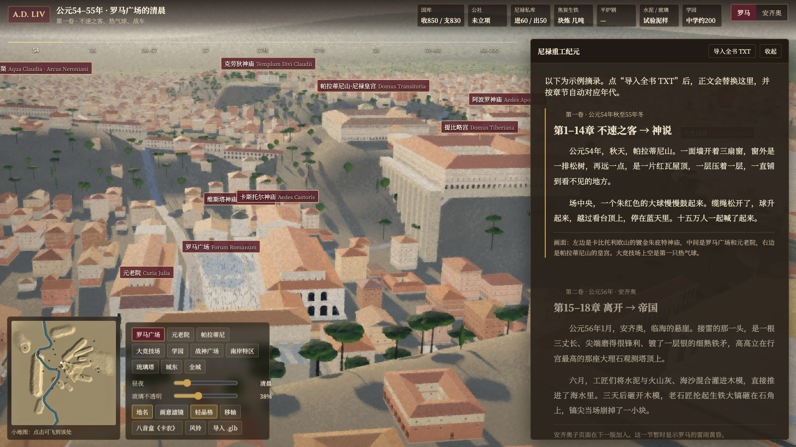
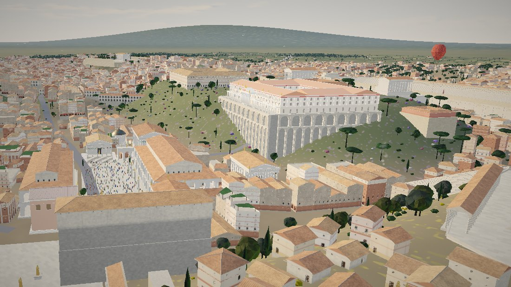
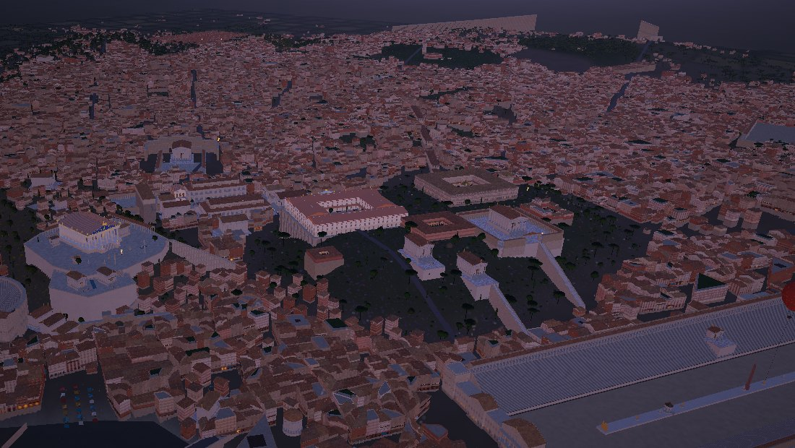

<h1 align="center">Building Rome in One Day</h1>

<p align="center"><b>Rome wasn't built in one day — but you can build your city in one day.</b></p>

<p align="center">Novel2City · 一个 Claude Skill：把你的小说，变成一座<b>随情节生长</b>的 3D 城市</p>

<p align="center">
<a href="examples/rome-day1.html">▶ 第一天的成品（一个 HTML 文件，浏览器直接打开）</a> ·
<a href="https://github.com/rainneko/nero_rome_visual">完整案例代码</a> ·
<a href="#之后token-花在资产精修上">花了多少 token</a>
</p>

| 第一天 | 两周之后 |
|---|---|
|  |  |

## 它做什么

把一本小说读成数据，把数据建成城市，再让城市**跟着情节走**：

* **城市随小说变化。** 读者往下读，城市跟着章节变：新建筑落成，工地和脚手架出现，夜里亮起油灯；
  点正文里的地名，镜头飞过去。这个技能从一开始就是为一本小说做的：城市围绕正文搭建，而不是一个通用的城市生成器。
* **一套完整流程：** 设定圣经（时间轴、钱、资源、工程进度）→ 地点表与时代状态 → 史料与时代过滤 →
  参考图打分 → 程序化城市肌理 → Blender 核心建筑 → 光与天气 → 阅读界面。每个阶段都有验收门。
* **案例：** 43 万字的历史基建小说《尼禄重工纪元》→ 公元 54–68 年的罗马。
  9 个时代状态，约 200 个历史地点，约 2 万地块，50 多个 Blender 核心建筑，581 处地名链接。
  代码在 **https://github.com/rainneko/nero_rome_visual**。

### In English
Novel2City is a Claude skill that turns a novel into a living, chapter-synced 3D city on the web: as the reader
scrolls, the city changes with the plot. It covers the story bible, history and period filtering, reference images,
procedural city fabric, Blender hero buildings with worker agents, lighting, and the reading UI. The case study is a
430k-character Chinese novel set in Nero's Rome. The whole city stood on **day one**; the next two weeks went into
refining assets. Every token is accounted for below.

## 第一天就能做完的事

作者估计用了 **1–2 个 5 小时额度**。成品就是 [`examples/rome-day1.html`](examples/rome-day1.html)，
一个 173 KB 的单文件，默认开着轻晶格油画滤镜。

第一天只做"对的骨架"，后面所有精修都建立在它上面：
1. 调研城市模型（开源城建游戏、程序化古城项目），定方案。
2. 选史料：地名词典、大理石平面图、复原图；列"那一年不存在的建筑"清单。
3. 从参考鸟瞰图量出各区的建筑密度。
4. 生成地形、道路、地标预留地块，低密度与高密度民居、神殿、皇宫。
5. 做阅读界面：正文、时代状态、地名标签、小地图、昼夜。

| 第一天用到的 skill / 思路 | 用来做什么 |
|---|---|
| **novel2city**（本技能） | 流程与验收门、设定圣经、时代过滤、参考图打分 |
| **城建游戏思路**（开源城建游戏 + 程序化古城 athenaion） | 地形 → 道路 → 地标预留 → 地块 → 窄楼错落；参考图驱动的程序化城市 |
| **无头截图** | 每一步都有截图为证 |

## 之后：token 花在资产精修上

后面的两周不再"建城"，而是给城市里的每一件东西配资源：核心建筑、道路、立面、地形衔接。
罗马案例按作者的订阅额度算，总共大约 **2 个周额度**。会话记录实测：10-21 至 10-23 一共处理 **11.2 亿 token**，
其中约 94 % 是缓存读取，真正新写入与输出的约 7 千万。

| 之后用到的 skill / 工具 | 用来做什么 |
|---|---|
| **Blender 无头建模 + 建模工人子代理**（Haiku） | 一次一件核心建筑：任务书 → 脚本 → 四机位渲染 → 修改清单 → GLB |
| **多 agent 分工** | 作者当导演；Opus 主控（计划、审图）；Sonnet 集成（代码、地形、着色器）；Haiku 建模；另一家模型当史学顾问 |
| **数字验收** | 悬浮检测、像素探针（颜色）、三角面预算、拼图审图 |

**一件东西大概要多少**（罗马实测，"处理量"含缓存读取）：

| 项目 | 处理量 |
|---|---|
| 一次就过的核心建筑（神庙、巴西利卡） | 2–3 M |
| 普通核心建筑，改 2–3 轮 | 约 10 M |
| 复杂建筑，改 4–5 轮又一直续用同一个工人 | 25–36 M |
| 一次集成阶段：新开的 Sonnet 完成 7–9 项任务 | 10–40 M |
| **道路系统**：自然生成的三级街道 + 陡坡阶梯（单项最贵） | 约 120 M |

预算规则见 [references/15-token-cost.md](references/15-token-cost.md)。罗马的逐项账本见案例仓库的
[making-of](https://github.com/rainneko/nero_rome_visual/tree/main/nero-rome-reader%20/docs/making-of)。
想量自己的花费，可以用 [`scripts/token_ledger.py`](scripts/token_ledger.py)，从 Claude Code 会话记录按 agent 和阶段汇总。

## 哪些有用，哪些不匹配（简版）

**有用：**
* Blender 无头建模 + 便宜的工人 agent + 共享积木库。配方写清楚时，一件建筑一次就过。
* "不许出现清单"和参考图打分：时代穿帮几乎都在这里被拦住。
* 新开工人 + 10 行交接，比续用长上下文的工人便宜 2.6–5 倍。
* 截图为证、拼图审图、用数字验收，而不是"再像参考一点"。

**不匹配：**
* 单物体照片重建流程（img2threejs）：用于街景参考的建筑时，35 M 只做到第一阶段。同一件用 Blender 只要 1.1 M。
  见 [16](references/16-img2threejs-trial.md)。
* 顶点 AO 烘焙：花了 31 M，效果小，文件大 1.7 倍。
* 照片投影贴图：参考图多是游戏截图，投影等于搬运别人的美术。

| | |
|---|---|
|  |  |
|  |  |

## 九个阶段（每个阶段都有验收门）

| 阶段 | 做什么 | 详细说明 |
|---|---|---|
| P0 立项与镜头 | 先定 5–10 个"英雄镜头"和阅读布局 | [SKILL.md](SKILL.md) |
| P1 设定圣经 | 从手稿抽出时间轴、钱、资源、工程进度，打【史】【设】【书中】标签 | [01-story-bible](references/01-story-bible.md) |
| P2 地点与状态 | 1 单位 = 1 米的坐标表；把全书切成时代状态 | [templates](templates/) |
| P3 史料与参考图 | "不许出现清单"、六项打分、从鸟瞰图量密度 | [02](references/02-history-and-sources.md) · [03](references/03-reference-images.md) |
| P4 技术骨架 | three.js、图层 + 状态、章节闸门、段落触发、测试工具 | [04](references/04-tech-architecture.md) |
| P5 城市肌理 | 地形、道路、地标预留、窄楼错落、防重叠、防留缝 | [05](references/05-city-fabric.md) |
| P6 核心资产 | 任务书、四机位预览、主控 + 工人（Haiku）循环、GLB 进网页 | [06](references/06-hero-assets.md) |
| P7 光与天气 | 昼夜关键帧、季节、天气、古代夜景 | [07](references/07-light-weather-time.md) |
| P8 阅读体验 | 地名链接、触发、资源栏、面板分层、全屏阅读 | [08](references/08-reader-ux.md) |
| P9 质检与发布 | 已知的坑、截图为证、拆仓库、自动部署 | [10](references/10-pitfalls.md) |

P0–P5 加上 P8 的骨架，就是"第一天"。P6、P7 和细节修整，就是"之后两周"。

## 怎么用

1. 安装技能：把 `novel2city/` 文件夹放进 Claude Code 的技能目录（例如项目里的 `.claude/skills/`），
   或在 Claude 应用的设置里上传技能压缩包（以官方文档为准）。
2. 准备：小说全文（或分卷）、你最想让读者看到的几个画面、几张你喜欢的风格图。
3. 对 Claude 说，例如：
   - "用 novel2city，先帮我从这本小说整理设定圣经。"
   - "帮我给第三卷的港口找参考图，并按六项打分。"
   - "把我的城市做成网页，读到第 3 章时镜头飞到广场。"
4. 想做核心建筑，需要本机装 Blender（无头运行即可）。

## 最贵的十个教训

1. 1 单位 = 1 米，第一天定死。
2. 每个建筑先问"那一年它存在吗"。
3. 参考图先打分再用；后世的城市模型只借密度和质感。
4. 先给地标预留地块，所有生成器共用一张占地登记表。否则"上一版的建筑"会压在新建筑上十几轮。
5. 墙体埋进地下，坡地加台基，桥加桥台，否则到处留缝或悬空。
6. 民居要窄、要错落；"八窗宽、六层高"的大方块像工厂。
7. 古代夜景是稀疏的油灯和火把，不是现代灯海。
8. 修改轮一律新开工人；两轮不过就写精确配方或数字验收。
9. 截图为证；没看到图就说"还没确认"。
10. 代码早拆模块；一个常量用在定义之前，就能让整页起不来。

## 目录

```
SKILL.md                     主流程（Claude 先读这个）
references/01–16             各阶段的方法、坑、多 agent、案例、参考链接、token 预算、工具对比
templates/                   设定圣经、地点表、状态表、任务书、参考图打分表、链接审批表
scripts/                     参考图量密度、占地登记表、区域实例探针、token 账本（scripts/tests/ 里有测试）
examples/rome-day1.html      案例第一天的成品（单文件）
evals/                       测试用例、触发测试问句、第一轮测试输出
assets/screenshots/          案例截图
```

## 致谢

本技能来自作者、Claude、Gemini 与小说编剧 agent 的一次长期协作。
借鉴：athenaion（参考图驱动的程序化古希腊世界）、bobeff/open-source-games（城建游戏）、
AWMC geodata（ODbL）、Natural Earth、Platner《古罗马地名词典》、斯坦福 Forma Urbis、皮拉内西数字项目。完整列表见
[references/12-sources.md](references/12-sources.md)。

## 许可

文档采用 [CC BY 4.0](https://creativecommons.org/licenses/by/4.0/)，脚本采用 MIT License。小说引文与 `examples/` 里的正文摘录版权归原作者。
